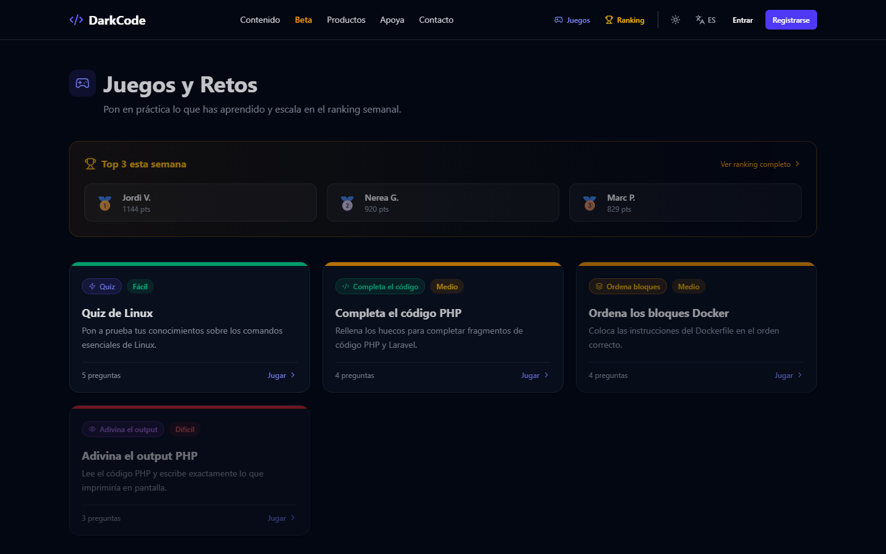
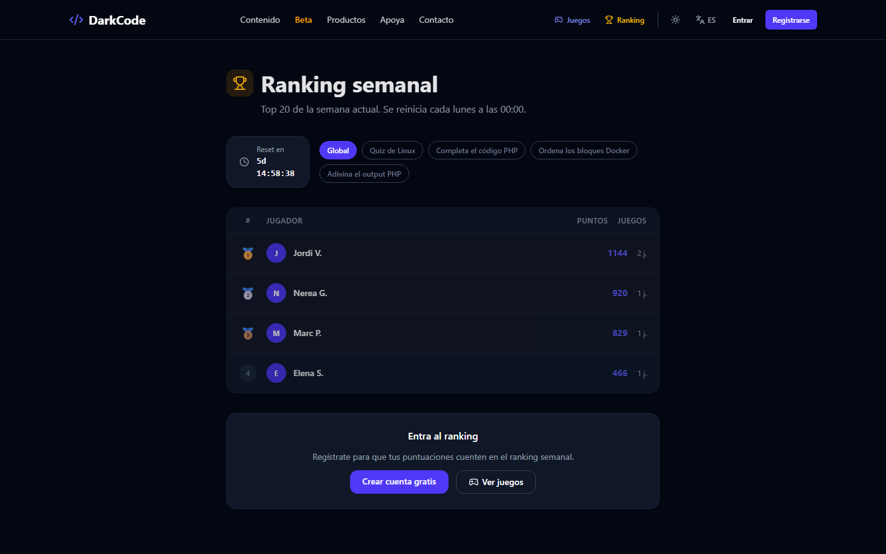
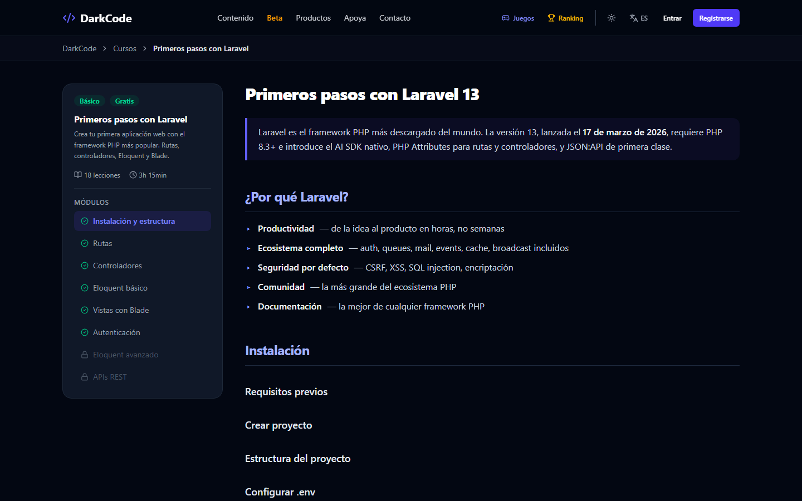

# darkcode

Plataforma full stack para aprender programación en español, hecha con **Laravel 13, Inertia y React 19 (TypeScript)**. Incluye cuentas de usuario con roles, lecciones, minijuegos con puntuaciones y ranking semanal, y un panel de administración.

> Proyecto de portfolio de [Alex Villar Gracia](https://alexvillar10.gitlab.io): una aplicación completa con backend, pensada para mostrar cómo diseño, protejo y pruebo una aplicación Laravel + React de punta a punta.

## Capturas

| Juegos con ranking semanal | Ranking por juego |
| --- | --- |
|  |  |



## Qué demuestra este proyecto

| Área | Implementación |
| --- | --- |
| Autenticación | Registro, login con "recordarme", cierre de sesión con regeneración de sesión y token CSRF |
| OAuth | Login con Google mediante Laravel Socialite, con vinculación de cuentas existentes por email |
| Recuperación de contraseña | Tokens aleatorios guardados con hash, caducidad de 60 minutos, invalidación tras el uso y respuesta genérica para no revelar qué emails existen |
| Autorización | Roles `user`, `premium` y `admin`; middleware de administración; control de acceso al contenido en el servidor |
| Juegos | Cuatro tipos (test, completar código, ordenar bloques, adivinar la salida); la corrección se hace en el servidor y las respuestas nunca se envían al navegador |
| Ranking | Puntuación semanal agregada con consultas SQL (`SUM`, `GROUP BY`, `HAVING`) |
| Integraciones | Webhook de pagos (Gumroad) autenticado con secreto compartido; emails transaccionales con Resend |
| Frontend | React 19 + TypeScript + Tailwind CSS 4 con Inertia (sin API REST intermedia), i18n (es/ca/en), tema claro/oscuro |
| SEO | Sitemap dinámico y datos estructurados JSON-LD por curso |
| Calidad | 47 tests automatizados (PHPUnit) y CI en GitHub Actions y GitLab CI |
| Despliegue | Docker y Docker Compose con PostgreSQL; estuvo en producción en Railway (Dockerfile + `railway.json`) |

## Arquitectura

```text
Navegador ── Inertia (React 19 + TS) ──▶ Laravel 13
                                          ├── Controladores: Auth, Google OAuth, PasswordReset,
                                          │   Game, Leaderboard, Admin, GumroadWebhook
                                          ├── Middleware: auth, AdminMiddleware, throttle
                                          ├── Modelos: User, Game, GameQuestion, GameScore
                                          └── PostgreSQL (SQLite en local y en tests)
```

- **Inertia** permite escribir páginas React que reciben los datos como props desde los controladores, sin mantener una API aparte.
- Las páginas viven en `resources/js/Pages`; las lecciones en `resources/js/Pages/Lecciones`.
- Los juegos y sus preguntas se cargan con `database/seeders/GameSeeder.php`.

## Seguridad

Durante la revisión del código para el portfolio corregí varios problemas, cada uno cubierto por un test:

- **Escalada de privilegios en el registro.** El rol de administrador se asignaba automáticamente a un email escrito en el código, y el registro no verifica emails: cualquiera podía registrarse con esa dirección y obtener el panel de administración. Ahora nadie obtiene permisos de administración al registrarse; se conceden desde el servidor con `php artisan user:make-admin <email>`.
- **Webhook sin protección si faltaba la configuración.** Si `GUMROAD_WEBHOOK_SECRET` no estaba definido, una petición sin token pasaba la comprobación (`null === null`). Ahora el webhook queda desactivado sin secreto y el token se compara con `hash_equals` para evitar ataques de tiempo.
- **Fuerza bruta.** Límite de intentos en login, registro, recuperación de contraseña y envío de puntuaciones.
- **Rutas de Inertia en Linux.** La configuración apuntaba a `js/pages` en minúsculas, lo que solo funcionaba en Windows; ahora apunta a `js/Pages`.

## Puesta en marcha

### Con Docker (recomendado)

```bash
cp .env.example .env
docker compose run --rm app php artisan key:generate --show   # copia la clave en APP_KEY del .env
docker compose up --build
```

Abre http://localhost:8080. Para darte permisos de administración después de registrarte:

```bash
docker compose exec app php artisan user:make-admin tu@email.com
```

### Sin Docker

Requisitos: PHP 8.4, Composer y Node 22.

```bash
composer setup          # instala dependencias, crea .env, genera la clave, migra y compila el frontend
php artisan db:seed --class=GameSeeder
composer dev            # servidor, cola, logs y Vite a la vez
```

### Variables de entorno opcionales

| Variable | Para qué |
| --- | --- |
| `GOOGLE_CLIENT_ID`, `GOOGLE_CLIENT_SECRET` | Login con Google |
| `RESEND_API_KEY`, `MAIL_MAILER=resend` | Envío real de emails (en local se escriben en el log) |
| `GUMROAD_WEBHOOK_SECRET` | Activa el webhook de pagos (vacío = desactivado) |

## Tests

```bash
php artisan test
```

```text
tests/
├── Feature/Auth/AuthenticationTest.php   login, errores, límite de intentos, logout
├── Feature/Auth/RegistrationTest.php     registro, validación, duplicados, sin admin automático
├── Feature/Auth/PasswordResetTest.php    envío del enlace, no enumeración, token válido/incorrecto/caducado
├── Feature/Auth/GoogleLoginTest.php      alta, vinculación de cuentas y errores de OAuth (Socialite simulado)
├── Feature/AdminTest.php                 acceso por rol, estadísticas, cambio de rol, validación
├── Feature/GameTest.php                  listado, respuestas ocultas, puntuación, ordenar bloques, ranking semanal
├── Feature/GumroadWebhookTest.php        token, secreto ausente, compra, reembolsos
├── Feature/MakeAdminCommandTest.php      comando de administración
└── Unit/UserTest.php                     permisos según el rol
```

## Autor

[Alex Villar Gracia](https://alexvillar10.gitlab.io) · Desarrollador Full Stack (Laravel + React) · [LinkedIn](https://www.linkedin.com/in/alexvg20)
